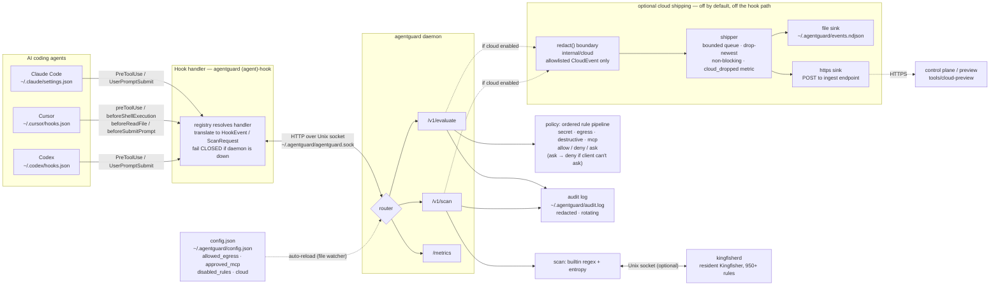
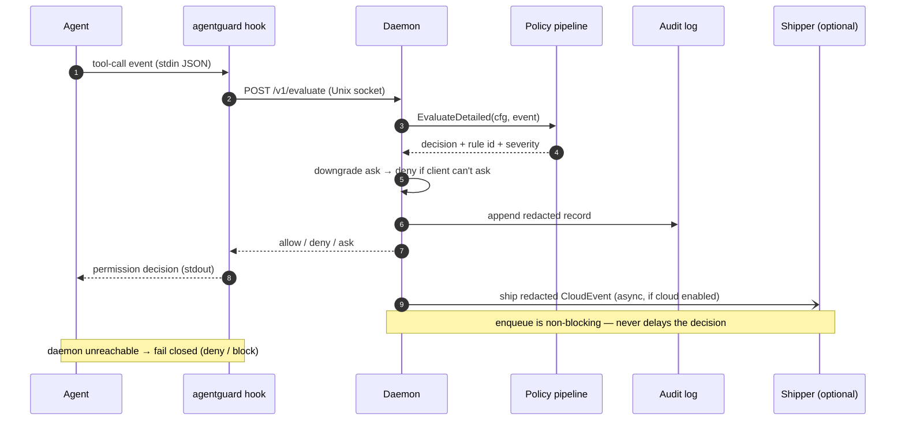
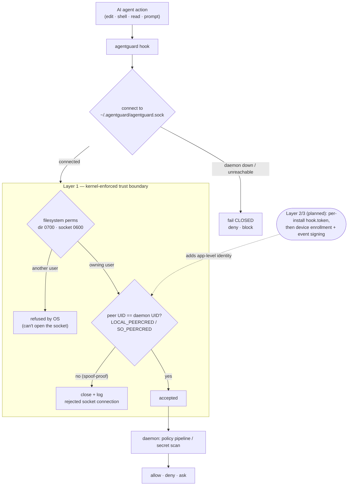

# AgentGuard — MVP

Local-first runtime guardrails for AI coding agents (Claude Code, Cursor, Codex).
It runs as a small **local daemon** on a **Unix domain socket** (no TCP port to
conflict with). Agents are wired via command hooks that send every tool
call to it, and it returns **allow / deny / ask** before the action runs.
Nothing leaves the machine — evaluation is local, and only a redacted one-line
record is written to a local audit log.

This is the pilot build: **local-first, no accounts, no multi-tenancy.** The goal
is to prove value on real machines with the least moving
parts. Optional redacted [cloud shipping](#cloud-shipping-optional-off-by-default)
exists but is **off by default**.

## Architecture

Each agent is wired with **command hooks** that spawn `agentguard <agent>-hook`.
That handler translates the agent's event into a common schema and asks the
**daemon** over a Unix domain socket for a decision. The daemon runs the policy
rule pipeline (tool calls) or the secret scanner (prompts), writes a redacted
audit record, and returns **allow / deny / ask**. Enforcement is fully local.
Optionally, a redacted projection of each decision can be shipped off the box
(file and/or HTTPS sinks) — **off by default, off the hook path**, and never
carrying raw secrets, commands, or paths (see [Cloud shipping](#cloud-shipping-optional-off-by-default)).



Request flow for a single tool call:



Adding a new agent is a single entry in the agent registry
(`internal/hooks/agent.go`); install, uninstall, the `--<agent>` CLI flag, and
runtime dispatch all pick it up automatically.

## Quick start

One command builds everything, installs the background daemon, wires up the
detected agents (Claude Code, Cursor, Codex), and (best effort) builds the
resident Kingfisher scanner. Prompts for your sudo password once:

```bash
make setup              # fresh machine: installs toolchains, then deploys everything
```

`make setup` is the do-everything path — it runs `bootstrap` (installs Go, Rust,
cmake, boost via Homebrew + rustup, skipping anything already present) then
`deploy`. Use it on a clean machine.

If your toolchains are already installed (CI, provisioned dev box), skip the
install step and just deploy:

```bash
make doctor             # (optional) check which toolchains you have
make deploy             # builds + installs daemon + hooks + kingfisherd (no toolchain install)
```

`make deploy` runs the `doctor` preflight automatically and is intentionally
**non-invasive**: it needs **Go** (and sudo) for the daemon and **Rust + cmake +
boost** only for `kingfisherd`, but it never installs them — `doctor` prints
exactly what to `brew install` for anything missing. If the Rust toolchain isn't
present, `kingfisherd` is skipped and inline scans use the builtin scanner (the
agent still runs); add it later with `make install-kingfisher`.

To poke at the pieces individually:

```bash
make build              # builds ./bin/agentguard
make run                # starts the daemon on ~/.agentguard/agentguard.sock

# in another terminal:
make test               # fires simulated tool-calls and prints decisions
```

> **Dogfooding gotcha:** if you've wired AgentGuard's hooks into your own editor
> and then develop *on this repo*, your editor's AI agent is gated by the daemon
> too. Stop the daemon (e.g. Ctrl-C on a foreground `make run` / `make run-local`)
> and the agent's own file edits, searches, and commands start **failing closed**
> (denied) until it's back up — by design. Keep the daemon running while you work:
> either leave `make run-local` up in a terminal, or use the installed
> `KeepAlive` service (`make install`), which auto-restarts it. This only affects
> foreground dev; installed users get the always-on service.

## Wire up your AI agents (Claude Code + Cursor + Codex)

One command wires every detected agent to the daemon. It auto-detects which are
installed and **safely merges** into existing config (backs up to `*.bak`,
idempotent):

```bash
agentguard install-hooks            # all detected
agentguard install-hooks --claude   # Claude Code only
agentguard install-hooks --cursor   # Cursor only
agentguard install-hooks --codex    # Codex only
agentguard uninstall-hooks          # cleanly remove our entries
```

- **Claude Code** gets a `PreToolUse` command hook (every tool call is checked)
  **and** a `UserPromptSubmit` hook (the prompt text is scanned for secrets
  before it's sent) — both run `agentguard claude-hook`.
- **Cursor** gets `preToolUse` + `beforeShellExecution` + `beforeReadFile` +
  `beforeSubmitPrompt` command hooks (`agentguard cursor-hook`) with
  `failClosed: true`. The generic **`preToolUse`** gate covers every tool that
  lacks a dedicated hook (e.g. `WebFetch`); shell and file reads defer to
  `beforeShellExecution` / `beforeReadFile` (no double-gating). Because Cursor's
  `preToolUse` accepts but doesn't enforce `ask`, AgentGuard downgrades those to
  a clean `deny`.
- **Codex** (`~/.codex/hooks.json`) gets `PreToolUse` + `UserPromptSubmit`
  command hooks (`agentguard codex-hook`) with `failClosed`. Codex shares Claude
  Code's hook wire format, so the same handler logic applies; its `PreToolUse`
  intercepts Bash, `apply_patch`, and MCP tool calls. Like Cursor's `preToolUse`,
  Codex can't render `ask`, so AgentGuard downgrades those to a clean `deny`.

The **`beforeSubmitPrompt`** gate is a ggshield-style secret scanner: before a
prompt is sent, it scans the prompt text and any attached files for secrets and
**blocks submission** if it finds them. This catches secrets that reach the
model's context outside the agent's read path (e.g. an open/attached `.env`),
which per-tool read hooks can't see in Cursor.

Both agents talk to the same daemon over the socket — one policy engine, one
audit log — and both **fail closed** (block) if the daemon is unreachable.

With the daemon running, both agents block or prompt on risky actions
automatically. (`make install` runs `install-hooks` for you.)

> Note: hook schemas evolve — verify against
> https://code.claude.com/docs/en/hooks and https://cursor.com/docs/agent/hooks
> before a wide rollout. Full distribution guide: [`packaging/README.md`](packaging/README.md).

## Run in the background (no terminal open)

Don't make developers babysit a terminal. Install the daemon as a background
service that starts at login and auto-restarts:

```bash
make install            # build + install + register launchd agent (macOS)
make service-status     # check it's running
make uninstall          # remove it
```

Or via Homebrew (`brew services start agentguard`). Full distribution guide —
private Homebrew tap, manual install, and Linux — is in
[`packaging/README.md`](packaging/README.md).

## Configuration

Policy lives in a JSON config. There are three locations — the repo files are
**sources**, while `~/.agentguard/config.json` is what an installed daemon
**actually runs**. Which one is live depends on how you start the daemon:

| File | Committed? | Cloud | Read by |
|---|---|---|---|
| `config.json` (repo) | yes — the clean default / installer source | off | `make run`; copied to `~/.agentguard/` on `make install` |
| `config.local.json` (repo) | no — gitignored, your machine only | on (testing) | `make run-local` |
| `~/.agentguard/config.json` | n/a — your home dir | your choice | the installed background daemon (the **live** config) |

```bash
make run         # foreground, uses repo config.json (cloud off)
make run-local   # foreground, uses config.local.json (cloud on → preview)
make install     # background service, reads ~/.agentguard/config.json
```

Schema (all fields optional):

```jsonc
{
  "allowed_egress": ["github.com", "..."],   // domains that DON'T trigger "ask"
  "approved_mcp":   ["github", "linear"],     // MCP servers allowed without "deny"
  "disabled_rules": [],                        // rule ids to turn off (see /metrics, audit log)
  "cloud": { "enabled": false, "sinks": [] }   // optional shipping — see "Cloud shipping"
}
```

**What hot-reloads vs. what needs a restart:**

- **Hot (≈2s, file-watched):** `allowed_egress`, `approved_mcp`, `disabled_rules`.
  Edit the file the running daemon was pointed at and save — no rebuild/restart.
  A malformed edit is logged and ignored, keeping the last good policy.
- **Restart required:** the `cloud` block. The event shipper is built once at
  startup, so adding/removing/changing sinks needs a daemon restart.

**Gotchas:**

- **One socket, one daemon.** All run modes bind the same socket
  (`~/.agentguard/agentguard.sock`), so you can't run `make run` / `run-local`
  *and* the installed service at the same time. Check with `make service-status`
  and stop the service before running in the foreground.
- **Keep cloud/testing tweaks out of `config.json`.** The committed `config.json`
  must match the built-in default (`defaultConfigJSON()` in
  `internal/server/server.go`), enforced by `TestDefaultConfigMatchesRepo`. Put
  personal/test settings in `config.local.json`; only change `config.json` when
  you intend to change the *default*, and update `defaultConfigJSON()` to match.

## What it blocks (Tier 1 rules)

| Scenario | Decision |
|---|---|
| Reads a secret **and** sends it over the network (`.env`, keys) | **deny** |
| Any read of `.env` / `~/.aws` / `~/.ssh` / `*.pem` / credentials | **deny** |
| Prompt (or attached file) containing secrets — Cursor `beforeSubmitPrompt` | **block** |
| Network call (`curl`/`wget`/…) to a domain not in `allowed_egress` | **ask** |
| Agent-native fetch (`WebFetch`/…) to a domain not in `allowed_egress` | **ask** |
| Destructive command (`rm -rf`, `git push --force`, `DROP TABLE`…) | **ask** |
| Call to an MCP server not in `approved_mcp` | **deny** |
| Everything else | **allow** |

> **`ask` across agents:** Claude Code renders `ask` as an interactive prompt.
> Cursor renders `ask` on `beforeShellExecution`, but its `preToolUse` surface
> (which gates `WebFetch`) does not — so AgentGuard downgrades `ask` to a clean
> **deny** there, with the same reason, attributed to `cursor` in the audit log.
> Codex's `PreToolUse` likewise can't render `ask`, so it gets the same
> downgrade, attributed to `codex`.

Tune `allowed_egress` / `approved_mcp` / `disabled_rules` in your config (see
[Configuration](#configuration)); the daemon auto-reloads policy within ~2s of a
save. `make service-reload` forces an immediate reload if needed.

## Secret detection backends

There are two scan paths, deliberately split by latency:

**Inline (the hooks)** — the **built-in** regex+entropy scanner is the always-on
baseline (sub-millisecond, never blocks). If the optional **`kingfisherd`**
resident scanner is running, inline scans *also* consult it for Kingfisher's
950+ rules — fast, because it compiles them once at startup (see below). If
kingfisherd is down or slow, we silently fall back to the builtin result, so the
hot path never blocks.

### Optional: kingfisherd (Kingfisher coverage, inline)

The Kingfisher CLI recompiles its 950 rules on every call (~4s) — unusable for a
blocking hook. `kingfisherd` (in `kingfisherd/`, a small Rust service built on
Kingfisher's library crates) pays that cost **once** at startup and then answers
scans in milliseconds over a Unix socket. AgentGuard auto-detects it.

```bash
brew install cmake boost                         # Vectorscan build deps
curl --proto '=https' --tlsv1.2 -sSf https://sh.rustup.rs | sh   # Rust toolchain (>= 1.94)
source "$HOME/.cargo/env"
make install-kingfisher                          # build + run as a launchd service
```

> If you installed Rust via `brew install rustup` instead, note the Homebrew
> formula no longer ships `rustup-init` and is keg-only — run
> `export PATH="/opt/homebrew/opt/rustup/bin:$PATH" && rustup default stable`.

Once it's up, the daemon log shows resident hits via the Kingfisher rule name in
the audit reason. No secret leaves the machine — kingfisherd never enables
validation.

**On-demand deep scan** — `agentguard scan [file|-]` uses
[Kingfisher](https://github.com/mongodb/kingfisher) (950+ maintained rules,
offline checksum validation) when it's installed, else the built-in scanner. Use
it for CI, pre-commit, or manual audits where its ~4s/call cost is fine:

```bash
brew install kingfisher
cat suspicious.txt | agentguard scan -      # exit 0 = clean, 200 = secret found
agentguard scan ./path/to/file
```

> Kingfisher is **not** used inline: it recompiles its 950 rules on every
> invocation (~4s), far too slow for a blocking hook. The deep-scan command
> always runs it with `--no-validate`, so **no secret is sent to a third-party
> API** — detection stays local. `agentguard scan` auto-detects Kingfisher on
> your `PATH` and falls back to the builtin scanner when it's absent — no config
> needed.

## Audit log

Redacted, append-only, one JSON object per line:

```
~/.agentguard/audit.log
```

Each record holds timestamp, tool, decision, and reason — **never** the raw
command, file contents, or secret values. Prompt-scan records also carry the
originating `agent` (`claude-code`/`cursor`) and a `findings` list naming **every**
secret detected (each with its `source` — `builtin` or `kingfisher` — and `rule`),
so a multi-secret prompt is fully attributed:

```json
{"ts":"…","tool":"Prompt","agent":"cursor","decision":"deny",
 "reason":"2 secrets detected in prompt (AWS access key id, GitLab Private Token)",
 "source":"builtin","rule":"AWS access key id",
 "findings":[{"source":"builtin","rule":"AWS access key id"},
             {"source":"kingfisher","rule":"GitLab Private Token"}]}
```

## Observing the daemon

Three surfaces, by purpose:

| What | Where | Use it for |
|---|---|---|
| Operational log (`slog`) | `/tmp/agentguard.err.log` | daemon start, config reloads, errors |
| Audit log | `~/.agentguard/audit.log` | per-decision redacted records |
| Live counters | `GET /metrics` (over the socket) | aggregate allow/ask/deny + scan totals |

```bash
tail -f /tmp/agentguard.err.log                                          # operational log
curl -s --unix-socket ~/.agentguard/agentguard.sock http://unix/metrics  # counters
make service-status                                                      # is it running?
```

The operational log path above is set by the launchd service. Running the daemon
in the foreground (`make run`) prints those same `slog` lines to your terminal
instead. `/metrics` returns a JSON snapshot, e.g.
`{"evaluate_total":2,"evaluate_allow":1,"evaluate_deny":1,"scan_total":0,...}`.

## Security: the local trust boundary

The Unix socket is the boundary between the AI agent and the daemon — whoever can
reach it can ask for a policy decision (and, with a cloud backend, attribute
events to your device). **Layer 1 (OS-level)** locks that down at startup, and is
in place today:

| Control | What it does | Enforced by |
|---|---|---|
| `~/.agentguard/` → `0700` | only the owning user can traverse to the socket/config/logs | filesystem perms |
| socket file → `0600` | only the owning user can connect | filesystem perms |
| **peer-UID check** | every accepted connection must come from a process running as the **daemon's own UID**; mismatches are closed + logged | kernel (`LOCAL_PEERCRED` on macOS, `SO_PEERCRED` on Linux) |

The peer-UID check is the backstop: it's **kernel-verified** (a caller can't
forge its UID) and holds even if the socket mode is ever loosened or the socket
lands in a shared directory. We deliberately do **not** verify the connecting
binary's path (raceable on macOS, low value). On platforms without a peer-cred
syscall (e.g. Windows) the check no-ops and the `0600` perms remain the gate.



Two independent gates protect the socket — the OS perms stop other users
outright, and the kernel peer-UID check is the un-spoofable backstop behind it.
A down daemon never silently opens: the hook fails closed before it even reaches
these gates.

**Verify it (after a restart, since perms/checks apply at startup):**

```bash
ls -ld ~/.agentguard                    # drwx------ (0700)
ls -l  ~/.agentguard/agentguard.sock    # srw------- (0600)
curl -s --unix-socket ~/.agentguard/agentguard.sock http://unix/healthz   # same user → 200
```

To exercise the peer-UID backstop in isolation (it normally sits behind the file
perms), run on a world-reachable socket, loosen it, and connect as another user:

```bash
# terminal 1
AGENTGUARD_SOCKET=/tmp/ag-test.sock ./bin/agentguard --config config.json
# terminal 2
chmod 666 /tmp/ag-test.sock
sudo -u nobody curl -s --unix-socket /tmp/ag-test.sock http://unix/healthz   # rejected
```

Even at `0666`, the daemon refuses the `nobody` connection and logs
`rejected socket connection err="peer uid … != daemon uid …"`. (Remove that test
socket afterward.)

> **Layers 2–3 (planned, land with the cloud ingest):** a per-install
> `hook.token` presented on the first frame of every connection, then device
> enrollment + event signing so the cloud can attribute and verify events
> per-customer/per-device and revoke a compromised machine. See
> [`docs/cloud-mvp.md`](docs/cloud-mvp.md).

## Cloud shipping (optional, off by default)

The agent can additionally ship a **redacted** projection of each decision/scan
off the box — for fleet visibility — without weakening local enforcement. It is
**disabled unless configured**, and enforcement never depends on it.

- One redaction boundary (`internal/cloud/redact.go`) builds an allowlisted
  `CloudEvent`: tool, decision, reason, rule, severity, finding `source`/`rule`,
  and `cwd_base` (basename only). **Never** shipped: raw secret values, prompt
  text, command strings, full paths, or session ids. A build-gating test
  (`internal/cloud/redact_test.go`) asserts none of those substrings can leak.
- A non-blocking `Shipper` (bounded in-memory queue, drop-newest on overflow,
  surfaced as `cloud_dropped` in `/metrics`) fans events to one or more sinks off
  the hook path. Two sink types ship today: `file` (local NDJSON at
  `~/.agentguard/events.ndjson`) and `https` (POSTs each event to an ingest
  endpoint). Fan-out is supported — run both at once.

Enable by adding a `cloud` block to `~/.agentguard/config.json`:

```jsonc
"cloud": {
  "enabled": true,
  "sinks": [
    { "name": "local",   "type": "file" },                                           // local NDJSON
    { "name": "preview", "type": "https", "endpoint": "http://localhost:8000/api/ingest" }
  ]
}
```

The shipper is built once at daemon start, so set sinks **before** running.
To watch events stream live over the `https` sink, use the local preview
control plane in [`tools/cloud-preview/`](tools/cloud-preview/) (FastAPI ingest
+ dashboard). See [`docs/cloud-mvp.md`](docs/cloud-mvp.md) for the full design
(enrollment, persistence, policy pull) and the redacted-event schema.

## What's next (post-pilot)

- **HTTPS sink + enrollment** and background **policy sync** from a cloud control
  plane (the redaction boundary and local shipper already land in M0, above).
- **Dashboard** for fleet-wide policy + audit visibility.
- **Tier 2+ detection** (classifier / behavioral / taint) behind the same
  `Evaluate()` interface.
- Packaging: signed/notarized prebuilt binaries + MDM (Jamf, Intune) for
  one-command fleet rollout. (Local build-from-source path already in
  `packaging/`.)

